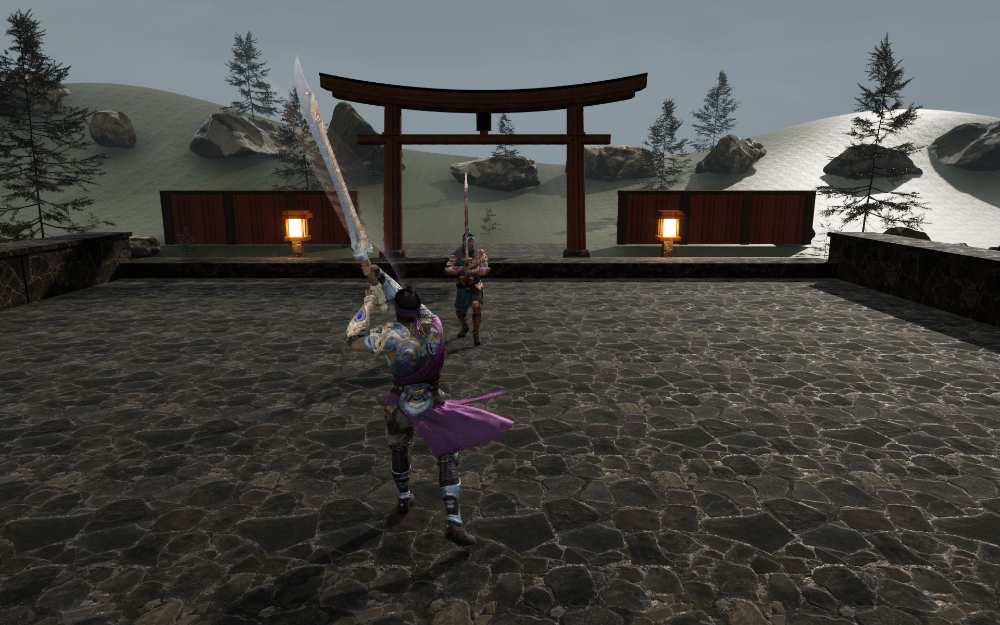
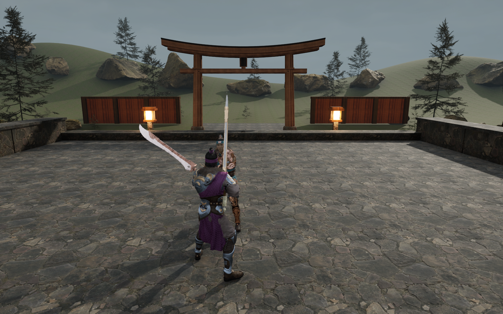

# Combat and visual correction — 2026-10-16

## Verified behavior

The Linux Unreal 5.7.4 editor module builds successfully. All seven engine integration tests pass with zero errors and zero warnings in [the recorded run](unreal-tests/run-20261016T100317Z-3CjYrv/index.json). The portable combat suite passes 434 checks and the haptics suite passes 2,465 checks.

Stamina is removed from the simulation and HUD. Attacks and dodges have no resource cost. Fresh guard/dodge presses can interrupt attack windup or recovery; stun, guard break and death remain committed. Dodges move a bounded 180 cm (210 cm in Gale), with a short evade window and vulnerable recovery. Evading a real in-range attack grants a counter opportunity. Successful parries allow a fresh timed deflection; held guard cannot regenerate posture.

Standard Xbox rumble uses independent bass/treble envelopes for movement, hits, blocks, clean evades, parries, received damage and finishers. Parry has a tested silent gap between its two pulses. Contact camera impulses are bounded and clear on pause, rematch and focus loss. Tests establish software signals, not their perceived feel on the controller.

## Rendered evidence

The GPU captured a real light attack and a parry against the native AI, after shaders settled, at 1920 × 1200. The attack shows the authored pose and a visible translucent trail. The parry shows small gold sparks near contact. These are single frames, not validation of the full animation transitions or precise blade-to-blade contact.

The parry capture also contains the original authored torii, shaped outer terrain and imported foliage. The surface-channel repair removes the large white mirror-like ground highlight seen in [the preceding scene](visuals/courtyard-v3.png). The surroundings are still sparse and the visual direction remains unfinished. Current gameplay still uses Kwang while an original armored samurai replacement is being prepared.

## Remaining acceptance

- Original armored samurai: reference prepared; a textured, rigged mesh has not been generated or integrated.
- Actual Xbox gameplay delivery and perceived parry/dodge/hit feedback.
- Animation and camera readability in sustained combat, including the faster evasive step and close-range occlusion.
- Better scene composition, foliage coverage, atmospheric motion, audio and contact alignment.
- Packaged Linux build and measured performance. These captures ran at a 30 fps cap and are not a 60 fps benchmark.

This revision is a correction to the playable prototype, not an AAA-quality acceptance claim.
