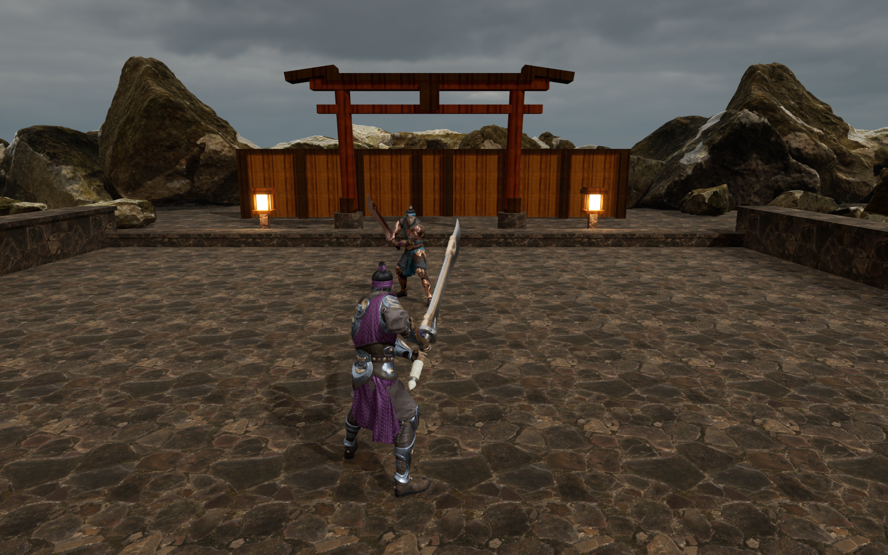

# Visual integration — 2026-10-16

## Character, trail lifecycle, and capture

The Linux Unreal 5.7.4 editor module built successfully with two compile workers. All six engine integration tests passed with zero errors and zero warnings in [the recorded run](unreal-tests/run-20261016T093233Z-c4GnSe/index.json). These checks include authored character animation, blade-trail assets and socket references, tick ordering, pause/hit-stop clock gates, and rematch reset.

The developer-only `ronin.Capture` command successfully waited for material shaders and wrote a fresh 1920 × 1200 PNG using the NVIDIA Vulkan renderer. The engine confirmed the 3,824,963-byte output and exited with status 0. This initial capture used the character/start-gate build before the blade-trail addition; it does not verify visible ribbon emission.

Observed: both authored Kwang appearances render with their materials and idle poses; character scale and floor contact are plausible. The courtyard still has a flat, brown palette, an oversized rocky backdrop, and a timber screen closing the gate's vista. The gate remains the earlier construction geometry. This image is a baseline for further work, not visual acceptance.

The capture waited at 30 fps to reduce background GPU load. It is not a performance benchmark. Actual trail emission/tails, combat animation transitions, sound, gameplay rumble, controller feel, and the packaged Linux build remain unverified by this run.
